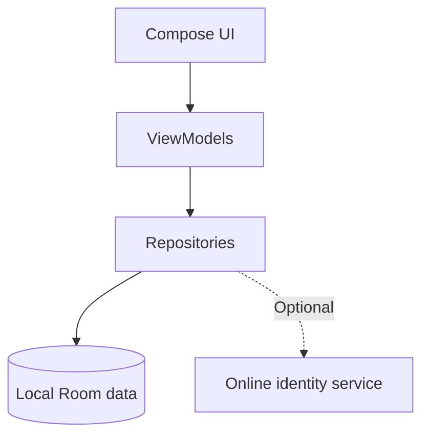

# Ampara

**Work in Progress · Academic Project · Android / Kotlin**

Ampara is an Android application being developed to help older adults and people with disabilities organize daily routines, medication reminders, and appointments. The project explores accessible interaction, local data persistence, and practical software architecture.

This repository is a **public portfolio showcase** of an ongoing academic project. **The application source code and original design assets are maintained privately** while the team evaluates future development and potential commercial opportunities.

> **Project status:** Under development. This is not a production release, medical device, or emergency-support service. Features and technical decisions may change.

## Main objectives

- Support daily routines through medication and appointment reminders.
- Provide adjustable accessibility settings and a clear user interface.
- Prioritize essential local workflows and data consistency.
- Explore optional online identity and caregiver-related features over time.

## Development progress

| Area | Status |
| --- | --- |
| Local registration, authentication, and sessions | Implemented; being validated |
| Initial user onboarding | Implemented |
| Routine planner and local history | Implemented; reliability validation ongoing |
| Local reminders and notifications | Implemented; device-specific testing ongoing |
| Profile and accessibility preferences | Implemented; accessibility validation ongoing |
| Optional online identity | Experimental / configuration-dependent |
| Remote caregiver pairing and data sharing | Not yet available |
| Local password recovery | Not available |
| Ara assistant | Interface and local history only; no conversational AI |

“Implemented” means the feature has a code implementation; it does not mean the feature has passed comprehensive release testing.

## Technologies

**Kotlin** · **Jetpack Compose** · **Material 3** · **MVVM-oriented architecture** · **Room** · **Hilt** · **Coroutines / Flow** · **Navigation Compose** · **AlarmManager / WorkManager** · **Supabase (optional)** · **Gradle / JUnit**

## High-level architecture

This diagram is illustrative; it does not disclose the complete implementation.

## Language and documentation

This public README is written in **English** for portfolio presentation. The application was originally developed in **Brazilian Portuguese (`pt-BR`)**. Its interface, source-code naming conventions, comments, and some project documentation are in Portuguese. An English localization is not currently available.

## Development priorities

Ongoing priorities include validating local data consistency, reminders, account workflows, accessible interaction on physical devices, and caregiver-related behavior. The team has not announced a public release date.

## Team and academic context

Ampara is a collaborative final project from a **Systems Development technical program**. Contributor credits and institutional acknowledgments will be added after agreement among the team members.

## Copyright and permitted use

**Copyright © 2026 the respective Ampara project contributors. All rights reserved.**

This repository is published for **portfolio viewing and evaluation only**. It does not provide a license to copy, reuse, redistribute, commercialize, or rebrand the project's original content. This does not override rights provided by GitHub's Terms of Service or applicable law. Third-party materials remain subject to their own licenses.

See [LICENSE.MD](LICENSE.MD). For permission to use project materials, written authorization from the appropriate rights holders is required.
